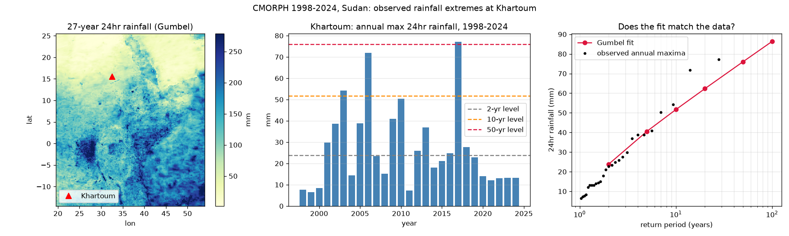

# Sudan 24-hour Rainfall Extremes — CMORPH 1998–2024

This repository documents an extreme-rainfall analysis for five Sudanese towns using 27 years
(1998–2024) of observed CMORPH rainfall. For each town in [`grid.json`](grid.json) the workflow
extracts the annual maximum 24-hour rainfall, reads the fitted Gumbel distribution parameters, and
produces a three-panel figure with:

1. the 27-year 24-hour rainfall map with the town marked,
2. the town's 27 annual maxima with 2-, 10- and 50-year return levels, and
3. the fitted Gumbel return-level curve against the observed annual maxima.

## Study locations

`grid.json` defines the five towns and a 1° × 1° box around each one.

| Town | Latitude | Longitude |
|---|---:|---:|
| Khartoum | 15.551772 | 32.532406 |
| Kassala | 15.450992 | 36.399980 |
| Gedaref | 14.034927 | 35.383444 |
| El Obeid | 13.184212 | 30.216694 |
| Nyala | 12.048882 | 24.880694 |

## Data

The analysis reads the public CMORPH return-period store directly; no credentials are required.

| Item | Value |
|---|---|
| Endpoint | `https://data.source.coop` |
| Bucket | `e4drr-project` |
| Prefix | `observations/cmorph_rp_icechunk` |
| Record | 1998–2024 (27 years) |
| Duration | `24hr` |
| Variables | `annual_maxima`, `return_period_precip`, `dist_location`, `dist_scale` |
| Stored return periods | 2, 5, 10, 20, 50, 100 years |

The store is an Icechunk/Zarr v3 dataset. Latitude is ascending (−14.5° to 25.5°) and longitude
runs from about 19.5° to 54.0°, covering all five towns.

## Method

For every town the nearest CMORPH pixel to the coordinates in `grid.json` is selected, and the
27-year series of annual maxima is read. Return levels follow the Gumbel distribution

```
x_T = μ − β · ln(−ln(1 − 1/T))
```

where `T` is the return period in years, `μ` is the Gumbel location parameter
(`dist_location`) and `β` is the scale parameter (`dist_scale`).

The store provides return levels for 2, 5, 10, 20, 50 and 100 years. The 27-year level is not
stored, so it is computed from `μ` and `β`; the same formula reproduces every stored level exactly.

### 27-year 24-hour return levels

| Town | 2-yr | 5-yr | 10-yr | 20-yr | **27-yr** | 50-yr | 100-yr |
|---|---:|---:|---:|---:|---:|---:|---:|
| Khartoum | 23.8 | 40.6 | 51.7 | 62.3 | **66.8** | 76.0 | 86.4 |
| Kassala | 37.9 | 51.6 | 60.6 | 69.2 | **72.9** | 80.4 | 88.8 |
| Gedaref | 53.0 | 64.9 | 72.8 | 80.4 | **83.7** | 90.3 | 97.6 |
| El Obeid | 37.2 | 51.9 | 61.7 | 71.0 | **75.0** | 83.2 | 92.2 |
| Nyala | 32.3 | 43.0 | 50.2 | 57.0 | **59.9** | 65.8 | 72.4 |

All values are 24-hour rainfall depths in millimetres.

Gedaref has the highest 27-year level (83.7 mm); Nyala has the lowest (59.9 mm).

## Figures

| Town | Figure |
|---|---|
| Khartoum | [`out/04_cmorph_return_periods_khartoum.png`](out/04_cmorph_return_periods_khartoum.png) |
| Kassala | [`out/04_cmorph_return_periods_kassala.png`](out/04_cmorph_return_periods_kassala.png) |
| Gedaref | [`out/04_cmorph_return_periods_gedaref.png`](out/04_cmorph_return_periods_gedaref.png) |
| El Obeid | [`out/04_cmorph_return_periods_el_obeid.png`](out/04_cmorph_return_periods_el_obeid.png) |
| Nyala | [`out/04_cmorph_return_periods_nyala.png`](out/04_cmorph_return_periods_nyala.png) |

Each figure is a single three-panel plot; one figure is produced per town (five figures total).



## Reproducing the analysis

The analysis script is included here as
[`scripts/cmorph_return_periods.py`](scripts/cmorph_return_periods.py), adapted from exercise 04 of
[`icpac-igad/python-workshop`](https://github.com/icpac-igad/python-workshop). It reads the towns
from `grid.json`, loops over them, and writes one PNG per town into `out/`.

From this repository directory, with the workshop environment available:

```bash
uv run --project ../python-workshop python scripts/cmorph_return_periods.py
```

The script accepts `--grid path/to/towns.json` to use a different town list. Results are written as
`out/04_cmorph_return_periods_<town>.png`; re-running overwrites the existing figures.

Dependencies: Python 3.12+, `icechunk`, `xarray`, `zarr`, `numpy` and `matplotlib`.

## Caveats

- Nearest-pixel sampling is not area-conservative regridding. CMORPH is approximately 8 km and the
  forecast grid referenced in `grid.json` is 0.25°.
- The Gumbel fit is based on 27 annual maxima. Return levels are estimates with sampling
  uncertainty, and the 27-year value is close to the length of the record.
- The analysis describes 24-hour rainfall extremes, not seasonal (JJA 2025) totals. The threshold is
  fitted to 1998–2024 observations.

## Repository layout

```
grid.json   Town coordinates and analysis metadata
out/        Five generated figures, one per town
scripts/    Analysis script (cmorph_return_periods.py) and supporting scripts
README.md   This document
```
